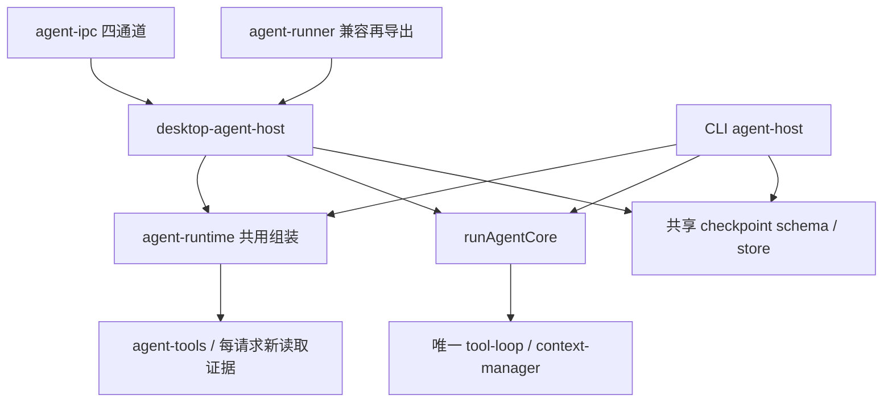

# 第五十八课：宿主边界收敛与 agent-runner 瘦身

当前状态（2026-10-11）：**产品实现及职责收口/续接安全补强的自动分层验收完成，用户本课实测确认待补，八题待答**；最新363项断网与四入口合成模型回归见[第9.6节](#96-职责收口与续接安全补强2026-10-11)。第9.1–9.5节的359项、原制品身份与创建时课稿保持历史，第56/57 open 项不升级。

创建日期：2026-10-11。状态：**课程已创建，产品实现与本课运行验收待进行；八道自测均待作答。**本轮只编写课稿并做最小导航同步，没有改写 `agent-runner`、未调用模型或构建应用。

前置：[第54课](69-第五十四课-UI与Agent逻辑拆分.md)已提供 `runAgentCore` 与唯一 `tool-loop`，桌面仍经 `agent-runner` 适配；[第55课](70-第五十五课-命令行与脚本入口.md)已确认 CLI/脚本薄宿主；[第56课](71-第五十六课-上下文整理与容量管理.md)有条件通过上下文整理；[第57课](72-第五十七课-跨进程可恢复的Agent任务续接.md)用户已确认完成，产品与自动分层验收见第9节（八道自测仍待答；真实联网模型/摘要续接未推定通过）。第56/57 **open 项继续后置**，本课不改写其结论。

维护入口见[tests/README.md](../tests/README.md)。会话版本9、设置版本1、第56冻结容量合同、第57 checkpoint v1 与「不复活票据」合同保持。用户明确：**暂时不做 MCP / Skills**；本课只做框架向宿主收敛。

## 1. 本课目标与前置条件

在**不改变对外业务合同**的前提下，收敛桌面/CLI/普通 Node 的宿主边界，把 `agent-runner.ts` 从「厚编排」收成「薄适配」：窗口生命周期、材料捕获、权限/审批转交、IPC 事件扇出、checkpoint 指针接线留在桌面宿主；模型/工具编排、整理水位、call_id 防重、公开副作用事实只留在 `runAgentCore` + 唯一 `tool-loop`（及已共享的无 Electron 模块）。

本课要让学习者能回答：

1. 创建时 `agent-runner` 里哪些职责属于宿主、哪些误留在了桌面适配层？
2. 瘦身后，桌面与 CLI 各自还允许保留什么？禁止再复制什么？
3. 怎样用断网夹具 + 双宿主回归证明「行为不变」，而不是「文件变短就算完成」？
4. 为什么本课不接 MCP/Skills，却能为以后接入留下单一工具注册面？

### 1.1 一句话目标

收敛宿主边界并瘦身 `agent-runner`：桌面只做薄适配，编排与工具循环只留在唯一核心，行为合同与第54–57课保护不变。

### 1.2 前置能力清单

| 课 | 必须带走 | 本课用法 |
| -- | -------- | -------- |
| 第54课 | `runAgentCore` / `AgentCoreDependencies`；窗口依赖本应在宿主 | 对照创建时 runner 厚度，把仍混在 runner 的编排迁回核心或纯模块 |
| 第55课 | CLI `agent-host` 薄路径；帮助/导入零启动 | 瘦身后 CLI 仍薄；禁止为「对称」把桌面厚度抄进 CLI |
| 第56课（有条件通过） | raw ≠ working；请求内整理；限额冻结 | 迁移不得旁路整理合同或抬限额 |
| 第57课（用户确认完成；自测待答） | TaskCheckpoint；显式继续 / `--resume`；不复活票据 | resume 接线可留在宿主，装载/校验/再水合合同不得桌面独占一份 |

### 1.3 明确不做

- **MCP、Skills、插件生态、SSH、远程执行、Computer Use、内置浏览器、一方网页搜索产品化**
- 并发多 Agent、自动更新产品化、会话库大迁移、CLI 多轮 REPL「持久会话」产品化
- 复活批准 / 读取凭据 / 命令票据；放宽第56 raw/working 容量；静默自动续跑
- 把第56/57 open 项改写成已通过；把「LOC 变少」写成「框架已稳」而不做回归
- 本课不要求回挂终端面板（`TerminalPanel` 仍可为孤儿面；见第7节下一步）
- 不新增第二套 tool-loop，不把 Electron `WebContents` 重新拖进核心

## 2. 用 Vue 经验理解本课

| Vue 中的经验 | 本课对应 | 要理解的区别 |
| ------------ | -------- | ------------ |
| 胖页面组件里又写 API 又写业务 | `agent-runner` 又管窗口又拼执行器 | 业务应进 composable/service，页面只接线 |
| `useXxx` 只暴露状态与方法，不持有 DOM | 核心只依赖注入的 transport/tools/observer | 核心不能 `import electron` |
| Pinia store 与路由守卫分层 | 权限策略 / 窗口 permission Map / 审批 UI 分层 | 策略可共享；windowId 状态必须留在桌面宿主 |
| 同一 API 给 Web 与 CLI 脚本用 | `runAgentCore` 给桌面、CLI、普通 Node | 禁止三套「差不多的」编排 |
| 重构用契约测试锁行为 | 本课以第54–57夹具与固定业务为行为锁 | 先锁行为再搬文件，避免「整理型破坏」 |

例如：创建时 runner 约数百行，直接 `import` 材料捕获、工具执行器工厂、摘要传输、checkpoint 保存等。瘦身后，runner 更像 Vue 里的「页面容器」：组装桌面依赖 → 调用核心 → 把事件打到 IPC；「算不算该整理、如何防重、如何构造 working」不应再散落在窗口函数里。

## 3. 当前实际文件与最小新增边界

以下按创建时源码核对；实施前必须重读当前版本。表中现有文件已存在；候选调整只表达职责，不预先当成已拆完。

| 当前文件 | 已有职责 | 本课复用或必要调整 |
| -------- | -------- | ------------------ |
| [agent-core.ts](../src/main/agent/agent-core.ts)、[agent-core-contract.ts](../src/main/agent/agent-core-contract.ts) | 唯一核心输入/事件/依赖/结局 | 收口仍散落在 runner 的编排；依赖面保持可普通 Node 注入 |
| [tool-loop.ts](../src/main/agent/tool-loop.ts)、[context-manager.ts](../src/main/agent/context-manager.ts) | 唯一循环与整理 | 不得复制；迁移后仍只一份 |
| [agent-runner.ts](../src/main/agent/agent-runner.ts) | 桌面 `runAgentRequest`、windowId Job、忙碌/取消 | **本课瘦身主战场**：迁出非窗口职责；保留窗口 Job map 与 IPC 友好入口 |
| [agent-ipc.ts](../src/main/agent/agent-ipc.ts)、[preload/agent-api.ts](../src/preload/agent-api.ts) | `agent:start/cancel/resume-info/resume` | 通道语义不变；实现可改为调用更薄的桌面宿主模块 |
| [agent-tools.ts](../src/main/agent/agent-tools.ts)、各 `tools/*`、[workspace-read-evidence.ts](../src/main/agent/workspace-read-evidence.ts) | 工具执行与读取证据 | 执行器组装应可被核心/共享工厂使用，避免仅 runner 能拼 |
| [desktop-checkpoints.ts](../src/main/agent/desktop-checkpoints.ts)、[task-checkpoint-store.ts](../src/main/storage/task-checkpoint-store.ts)、[task-checkpoint.ts](../src/shared/task-checkpoint.ts) | 第57续接 | 桌面可保留路径选择与 UI 触发；装载/校验保持共享 |
| [permission-state.ts](../src/main/execution/permission-state.ts)、[permission-policy.ts](../src/shared/permission-policy.ts)、审批/授权相关 | 窗口权限与共享策略 | 窗口 Map 留宿主；策略/判定逻辑不因瘦身复制第二份 |
| [task-registry.ts](../src/main/execution/task-registry.ts)、[task.ts](../src/shared/task.ts) | 进程内任务记录 | 不把 Job/Abort 句柄塞进共享类型；状态语义勿与 checkpoint 进度混名不说明 |
| [agent-host.ts](../src/cli/agent-host.ts) 等 `src/cli/*` | CLI 薄宿主 + resume | 对照桌面：CLI 已薄则少动；禁止反向变厚 |
| [useChatRequest.ts](../src/renderer/src/features/chat/useChatRequest.ts) 等 | 发送/停止/继续 | 对外交互不变；不借机改产品交互 scope |
| [TerminalPanel.tsx](../src/renderer/src/features/terminal/TerminalPanel.tsx) 等终端栈 | 终端能力已存在但 App 未挂载 | **本课不回挂**；只在文档标为后置 |
| [tests/README.md](../tests/README.md)、[package.json](../package.json) | 离线/真实分组 | 新增本课最少维护源：宿主边界断言 + 回归 suite |

**建议调整（实施时择最少文件，名称可调整）：**

- 抽出 `desktop-agent-host.ts`（或同级）：窗口 Job、材料/权限捕获、observer→IPC、显式 resume 触发
- 抽出或复用「执行器/依赖组装」纯函数：桌面与（若需要）测试夹具共用，核心不感知 `windowId`
- 可选：`host-boundary` 断网测试，断言核心模块依赖图不含 `electron`，runner/host 不含第二套 loop

完整 CLI 可达闭包继续无 Electron 运行时依赖；公共模块导入不得启动模型、工具或 writer。

## 4. 按依赖顺序实施与练习

整课一次交付，步骤按依赖拆成 §4A / §4B。两阶段共用同一课号与同一验收总表。本课以**行为保持型重构**为主：先冻结「宿主允许清单」，再搬代码，再回归。

### §4A 阶段：冻结宿主合同与可测边界（先量后搬）

#### 步骤一：基线盘点与允许清单

1. 核对 Git、未提交改动、当前源码/产物与第57证据身份；用新 UUID 建本课基线。不覆盖用户库、工作目录或旧证据，不提交/重置 Git。  
2. 盘点 `agent-runner.ts`：按「窗口/IPC」「材料捕获」「执行器组装」「核心调用」「checkpoint」「其它」分类行或符号。  
3. 写下**宿主允许清单**（写入本课第9节草稿亦可）：  
   - 允许：`windowId` Job/Abort、忙碌查询、取消、WebContents/IPC 扇出、桌面材料/图片/工作区捕获、窗口 permission revision 读取、审批/问答 UI 桥、桌面 checkpoint 路径与显式继续触发  
   - 禁止留在 runner：第二套模型/工具循环、working/整理策略副本、call_id 防重私货、批准/凭据/票据持久化、与窗口无关的纯协议变换  
4. 记录创建时 runner 行数/符号数与核心依赖边（仅作前后对比，**不是**唯一验收标准）。

**预期效果：** 有一张「什么可以留在桌面」的冻结表。  
**常见错误：** 没清单就开始「大搬家」，最后行为漂移却说整理完成。

#### 步骤二：核心/共享可达性断言（断网）

1. 增加最少维护测试：`agent-core` / `tool-loop` / `context-manager` / checkpoint 装载等**不得**静态依赖 `electron`。  
2. 断言桌面入口仍只通过宿主模块接触 `WebContents`/`ipcMain`。  
3. 若发现核心已误依赖 Electron：本课优先切断，不得用「暂时 any」糊弄。  
4. 普通 Node 仍能 `runAgentCore`（合成 transport）跑通既有核心夹具。

**预期效果：** 「核心可无界面」有自动护栏，而不是口头约定。  
**常见错误：** 只测 CLI 打包成功，不测依赖方向。

#### 步骤三：行为锁（重构前红线）

在搬代码前固定要回归的行为锁（合成优先，真实后置到 §4B）：

1. 第55/56/57 默认 `npm test` 相关断网套件仍全过（或明确列出本课必须带上的 suite）。  
2. 桌面：已有任务新 PID 重开相关请求分类为 0；显式继续仍要用户动作。  
3. CLI：无 `--resume` 保持单次空历史；帮助/导入/无任务新进程零启动。  
4. 不复活票据：续接后再水合夹具仍证明批准/凭据/命令准备空启动。

**预期效果：** 搬家后有可比对的绿线。  
**常见错误：** 删掉「碍事」的旧断言来让重构通过。

### §4B 阶段：搬迁、接线与双宿主回归

#### 步骤四：抽出桌面薄宿主

1. 将窗口 Job map、`runAgentRequest` / cancel / busy、IPC observer 适配迁到明确桌面宿主模块（名称自定）。  
2. `agent-ipc.ts` 只转发到该宿主；preload/renderer 合同不变。  
3. runner 文件若保留，应变为薄再导出或删除重复；避免长期「runner + host」双份编排。  
4. 材料捕获与执行器组装：能下沉为无 `windowId` 的纯组装函数则下沉；必须读窗口状态的留在宿主。

**预期效果：** 读桌面入口时，一眼能分清「适配」与「编排」。  
**常见错误：** 只把代码剪切到新文件，依赖方向与职责表未变。

#### 步骤五：对齐 CLI 宿主边界（少改）

1. 对照 `src/cli/agent-host.ts`：确认 CLI 不因桌面重构变厚。  
2. 若桌面抽出了可共享的「依赖组装」，CLI 可改为调用同一组装；**不得**为了共用而引入 Electron。  
3. `--resume` / checkpoint 路径保持第57合同。

**预期效果：** 两边都薄，且共用纯模块而非共用窗口概念。  
**常见错误：** 「桌面怎么写 CLI 就怎么抄」。

#### 步骤六：权限与任务状态的文档化边界（可小改，忌大爆）

1. 标明：`permission-state`（window Map）vs `permission-policy`（纯策略）vs 审批 UI vs checkpoint 进度枚举。  
2. 若存在命名冲突或调用链绕圈，本课允许**最小**重命名/门口函数收敛；不做权限产品新功能。  
3. 不把窗口 permission revision 写入 checkpoint。

**预期效果：** 后续接 MCP 时知道「策略挂哪里、UI 挂哪里」。  
**常见错误：** 借机重做整套授权系统。

#### 步骤七：分层检查与双宿主回归

1. 断网：依赖方向、宿主允许清单相关断言、第55 I/O/shared、第56 context、第57 checkpoint/再水合等本课声明保留的 suite。  
2. 开发桌面 + Windows 目录包：至少一条既有固定业务或第57续接路径可核对（合成/真实分记）。  
3. 开发 CLI + 分发 CLI：无 resume 与有 resume 各至少一条不回归；帮助/导入零启动。  
4. 静态：Node/Web/CLI 类型、必要 lint/格式、构建与制品身份；测试前后身份不漂移。  
5. 对比步骤一行数/职责表：runner（或后继桌面宿主）中「禁止项」应为 0；允许项集中可导航。

**预期效果：** 「更瘦」和「没坏」同时成立。  
**常见错误：** 只用单元测试代替双宿主回归。

#### 步骤八：文档与证据收口

追加本课第9节：实际模块图、允许清单终表、迁出符号列表、各层结果、失败/未覆盖、产物身份、复跑命令。对 README / 学习路线 / 学习进度 / 结构地图做**最小一行**当前指向。八题保持待答。第56/57 open 项在报告中继续标 open。

## 5. 验收条件与方法

创建时以下全部**待验收**。实现完成、自动分层、用户实测确认、八题掌握分别记录。第56/57 open 项即使本课通过也仍标 open。

| 层级 | 必须核对 | 创建时状态 |
| ---- | -------- | --------- |
| 宿主允许清单 | 清单冻结；runner/桌面宿主无禁止项职责 | 待验收 |
| 核心无 Electron | 依赖断言或等价静态检查通过 | 待验收 |
| 行为锁 | 本课声明的 55/56/57 断网 suite 不因重构失败 | 待验收 |
| 桌面薄入口 | IPC 合同不变；重开零请求精神保持；显式继续仍需用户动作 | 待验收 |
| CLI 不反向变厚 | 无 resume / resume / 帮助导入零启动保持 | 待验收 |
| 不复活票据 | 再水合与批准空启动夹具仍过 | 待验收 |
| 容量合同 | 第56 raw/working 限额未放宽 | 待验收 |
| 双宿主回归 | 开发+目录包桌面、开发+分发 CLI 至少各有声明路径可核对 | 待验收；合成/真实分记 |
| 静态/构建 | 类型、lint/格式、构建/分发身份 | 待验收 |
| 证据/文档 | 新 UUID、失败保留、不改第56/57结论与各课八题 | 待验收 |

**诚实边界：**

- LOC 下降是观察指标，不是通过条件  
- 未回挂终端不得写「桌面交互宿主已完整」  
- 未做真实联网不得把合成回归写成真实模型通过  
- 第56 EPERM / 真实多图 / 自然修错、第57 真实联网 resume / 自测待答继续 open

## 6. 八道自测题

状态：**八题均待作答，不附参考答案。**

1. 宿主允许清单里，为什么 `windowId` Job map 可以留在桌面，而 working 整理策略不能？  
2. 如何用一条自动检查证明 `runAgentCore` 不依赖 Electron？只证明 CLI 能跑够不够？  
3. 瘦身前后若固定业务结果一致，但重开后自动发了主请求，算通过吗？为什么？  
4. CLI 已经较薄时，本课对 CLI 的正确态度是「对齐共用纯模块」还是「补厚成桌面那样」？  
5. `permission-state` 与 `permission-policy` 分工是什么？哪一层将来更适合挂「MCP 工具也要走的 ask/review」？  
6. 为什么本课明确不做 MCP，却仍要求单一工具组装面？缺了它接 MCP 时会复制什么？  
7. 第57 checkpoint 的装载校验若只留在 `agent-runner`，会破坏第55/CLI 的什么性质？  
8. 哪些证据只能证明「文件拆分」，哪些才能证明「双宿主行为未回归」？哪些 open 项禁止写入本课通过？

## 7. 学习记录与下一步

本轮仅创建第58课课稿，并对学习计划 README、学习路线、学习进度做**最小一行级**导航更新；不修改产品源码，不改写第56/57验收结论与证据。创建时八道自测待答，产品实现待进行。

实施时建议顺序：先完成 §4A 清单与行为锁，再 §4B 搬迁与双宿主回归；两阶段均可在本课第9节分表记录，不必拆成两个课号。

**与既有 open 项（后置，本课不关闭）：**

| Open 项 | 本课态度 |
| ------- | -------- |
| 第56 用户实测确认 / 八道自测 | 后置 |
| 第56 原生资源符号链接 EPERM | 后置 |
| 第56 真实多图整理回归 | 后置 |
| 第56 自然「改坏→同任务再修」 | 后置 |
| 第57 八道自测；真实联网模型/摘要续接 | 后置；不推定通过 |
| 终端面板回挂（独立交互宿主） | 后置；不进 tool-loop |

**下一步（实施完成并有证据后讨论，不提前实施）：**

1. 终端面板回挂（用户交互宿主，非 Agent 工具）  
2. 权限与任务公开状态机的进一步对齐（若本课只做了文档化）  
3. 文档消噪（导航顶栏与各课第9节真相一行化）  
4. **再之后**才考虑 MCP 只读教学接入（用户已声明暂缓 Skills/MCP）

未完成本课行为保持回归前，不宣称「框架已适合接 MCP」。

## 8. 可复制到新对话的完整实施指令

以下供新对话明确实施第58课使用；**本轮创建课稿不执行其中产品、模型、构建和业务验收动作。**

```text
开始完成第58课：宿主边界收敛与 agent-runner 瘦身。
项目目录：D:\AiTools\ZoneCodex\ZoneCodex
先读取：
D:\AiTools\ZoneCodex\ZoneCodex\ZoneCodex学习计划\73-第五十八课-宿主边界收敛与agent-runner瘦身.md
严格按课程第8节与第4节（含§4A/§4B）实施，并按第5节完成分层验收。课程已创建，本次直接实施，不停留在只提计划。

按需读取编写约定、结构地图、学习进度、第54/55/56/57课实际合同与证据边界、tests/README.md。先核对当前源码、产物、Git 未提交改动。第56课有条件通过；第57课用户已确认完成但八道自测与真实联网 resume 等仍为 open——均不得改写为全部通过。保留所有未提交改动、用户库、工作目录、旧证据，不提交或重置 Git。

目标：在不改变对外业务合同、不复活批准/读取凭据/命令票据、不放宽第56容量的前提下，收敛桌面/CLI/普通 Node 宿主边界并瘦身 agent-runner：窗口生命周期、材料捕获、权限/审批转交、IPC 扇出、checkpoint 指针留在桌面薄宿主；编排与唯一 tool-loop 只留在 runAgentCore。不做 MCP/Skills/SSH/并发/自动更新/终端回挂/CLI REPL 持久会话。

§4A：冻结宿主允许清单与禁止项；盘点 runner 职责；增加核心无 Electron 等断网边界断言；锁定 55/56/57 相关断网 suite 与「不复活票据」夹具作为搬家前行为锁。
§4B：抽出桌面薄宿主并保持 IPC/preload/renderer 合同；CLI 只对齐共用纯模块、禁止反向变厚；最小文档化 permission-state vs policy；开发/目录包桌面与开发/分发 CLI 回归；类型/lint/格式/构建与制品身份；追加第9节与最小导航。

验收：合成与真实分记；新 UUID；LOC 仅作观察；八题保持待答。第56/57 open 项与终端回挂在报告中继续标后置。
```

## 9. 本轮实施与分层验收记录（2026-10-11）

**产品实现完成，本轮自动分层验收通过；用户本课实测确认待补，八道自测继续待答。** 本轮直接实施 §4A/§4B，没有停留在课稿。模型/摘要使用合成传输，实际 Node/Electron、新 PID、隔离磁盘、补丁、备份及独立业务测试分别记录；未执行真实联网模型/摘要续接，不将其升级为通过。

总证据 UUID 为 `72426f3f-716b-4e00-8d9a-3ccec7294516`，HEAD 前后为 `94b44c16a8cd7917f9fda0d9c7225856b172a8f6`。[总报告](../.ui-check/lesson58/implementation-72426f3f-716b-4e00-8d9a-3ccec7294516/final-report.json)、[基线](../.ui-check/lesson58/implementation-72426f3f-716b-4e00-8d9a-3ccec7294516/baseline.json)与[证据导览](../.ui-check/lesson58/implementation-72426f3f-716b-4e00-8d9a-3ccec7294516/README.md)保存本轮新结果。开始时已有第57产品及文档等未提交改动；原改动、用户库/工作目录和旧证据保留，未提交、重置或清理 Git。

### 9.1 §4A 冻结与搬迁前行为锁

搬迁前已保存[宿主允许清单](../.ui-check/lesson58/implementation-72426f3f-716b-4e00-8d9a-3ccec7294516/host-contract-frozen.md)，盘点 runner 的窗口/IPC、材料、执行器组装、核心调用、checkpoint、trace/timing 六类职责与符号；原文件副本保留在本轮证据目录。

| 冻结职责                                                                       | 最终归属与检查                                               |
| ------------------------------------------------------------------------------ | ------------------------------------------------------------ |
| 允许：windowId Job/Abort、busy/cancel、窗口生命周期与 IPC 扇出                 | `desktop-agent-host.ts`；runner 只再导出原六个入口           |
| 允许：当前/历史图片、附件、工作区捕获与当前 execution/permission revision 复核 | 桌面宿主及既有窗口服务；图片传输包装继续由宿主接线           |
| 允许：审批/计划问答 UI 桥、进程内 task 状态、checkpoint 路径与显式继续         | 桌面宿主接现有 broker/store；CLI 保留其自身交互和路径桥      |
| 禁止：第二套模型/工具循环、working/整理策略、call_id 防重副本                  | 宿主中为 0；只由 `runAgentCore` 调用唯一 `runToolLoop`       |
| 禁止：批准/读取凭据/命令票据持久化或恢复、窗口 revision 入 checkpoint          | 共享 schema/再水合夹具继续拒绝；每次创建新执行器证据         |
| 不应由宿主独占：工具选择、主/摘要传输与开销、无窗口执行器组装                  | 两宿主共用 `agent-runtime.ts`，闭包不达 Electron/桌面 broker |

搬迁前实际运行当前第57调度的九套行为锁，**349 项通过**：I/O 54、shared 八套 226、context-core 22、context-disk 4、host 11、adapters 9、checkpoint 13、core 9、cli-terminal 1。证据为 [搬迁前断网报告](../.ui-check/test-runs/lesson57/offline-group-d3a1bcdc-5b4a-47d0-b355-deb137291b99/results.json)，并非继承第57旧计数。原保护断言保留，只调整搬迁后的替身接线和源码身份清单。

### 9.2 §4B 实际模块与迁出符号



迁出列表：`jobs`、`hasAgentJob`、`abortProjectJob`、`abortImageJob`、`isAgentBusy`、`cancelAgentJob`、`runAgentRequest` 及其材料/事件/checkpoint 桥迁到 [desktop-agent-host.ts](../src/main/agent/desktop-agent-host.ts)；`buildAgentRequest`、固定配置主/摘要 transport、`networkOverhead` 汇总和 `createAgentToolExecutor`/附件 plan-vs-execute 执行器选择，收口到 [agent-runtime.ts](../src/main/agent/agent-runtime.ts) 的 `createAgentRuntime` / `createAgentRuntimeTools`。核心和工具循环不增加第二份。

[agent-ipc.ts](../src/main/agent/agent-ipc.ts) 直接转发桌面宿主；四通道及结果/事件合同保持，preload、renderer 和 shared API 字节与本轮基线相同。[agent-runner.ts](../src/main/agent/agent-runner.ts) 保留旧生命周期消费者的兼容导出；没有 runner/host 两套 Job Map。[CLI agent-host](../src/cli/agent-host.ts) 只替换共用组装，目录/指令复核、权限回调、writer、单次空历史及显式 `--resume` 合同保持；完整静态闭包不达窗口状态。

权限与任务的最小边界说明：`permission-state.ts` 拥有窗口 mode/revision Map，模式改变才递增 revision；`shared/permission-policy.ts` 为无窗口纯 allow/review/ask/deny 决策。共享 `workspace-authorization.ts` 持有真实授权和一次命令计划流程，`action-authorization.ts` 接桌面 owner/审批 broker；问答桥是计划信息，不是批准。`task-registry.ts` 是进程内状态及 cancel/IPC，checkpoint v1 的 `interrupted/resumable/completed/abandoned` 是磁盘进度，二者不能互当运行句柄；窗口 revision、批准、读取凭据、命令票据都不写入 checkpoint。

### 9.3 按第5节分层验收

| 层级            | 本轮最终结果与证据边界                                                                                                                                               |
| --------------- | -------------------------------------------------------------------------------------------------------------------------------------------------------------------- |
| 宿主允许清单    | 已冻结并按上述终表收口；runner 无可执行语句，宿主禁止项静态断言通过                                                                                                  |
| 核心无 Electron | 含类型导入的核心/checkpoint、共享 runtime/policy、完整 CLI 静态闭包分别 19/45/57 模块；外部仅 Node builtins，无桌面 state/broker                                     |
| 行为锁          | 最终默认 10 套 **359 项通过**（原 349 + boundary 10），[最终断网组](../.ui-check/test-runs/lesson58/offline-group-82ffce98-d3ca-46de-8ec9-90b03c6a3207/results.json) |
| 桌面薄入口      | 开发与目录包实际 Electron UI 停止→保存→新 PID 被动重开/切换零主请求及零摘要请求→点击继续；原记录与新 requestId 保持，IPC/preload/renderer 合同未变                   |
| CLI 不反向变厚  | 开发/实际 `agent.cmd` 分发各 6 组通过；无 resume 原历史严格空；帮助/库导入/入口导入/无任务新进程零启动，resume 输入互斥/目录漂移/坏文件在请求前拒绝                  |
| 不复活票据      | 原 checkpoint/core/cli-terminal 全过；续接旧读取 hash 不授权 patch，重读后重新建立当前批准；旧命令准备不再水合，存储失败不擦掉真实副作用/raw事实                     |
| 容量合同        | boundary 逐项冻结全部 11 个 `contextLimits`：raw 160/128000、working 128000/触发 96000 及全部摘要预算未放宽                                                          |
| 双宿主固定业务  | 开发桌面 PID 2624→37732，目录包 13656→36588；两版 CLI 新 PID 显式续接；四入口均完成实际读/补丁/重读及独立固定八例业务测试；**模型/摘要均合成**                       |
| 静态/构建       | Node/Web/CLI 类型、12 份相关代码 lint、13 份代码/配置格式、开发构建、Windows 目录包与双 CLI 构建通过；使用本机 Electron 分发目录打包                                 |
| 证据/文档       | 本课新 UUID、基线/先后报告与失败记录保留；追加本节、测试维护入口和最小导航；第54–57原文及各课八题不改                                                                |

[最终 boundary](../.ui-check/test-runs/lesson58/host-boundary-251ddde9-3c1c-496c-9d7c-91f5b11aa6de/results.json)另验普通 Node 合成主请求 2/工具 1，4 个新 PID 导入核心/共用工厂/CLI 库/CLI 入口，网络、进程、writer、checkpoint 装载、凭据读取、exit 六类均 0。两个故意吞掉错误的 microtask 反例仍被拦截并以计数 1/退出码 1 结束；它们是护栏自验证，不是产品失败。

[最终 CLI 双入口组](../.ui-check/test-runs/lesson58/resume-cli-group-3e5cedc9-2a3c-45a7-8267-63bdb51483ca/results.json)与[最终桌面双入口组](../.ui-check/test-runs/lesson58/resume-desktop-group-b682e093-0f04-43ff-8bfb-91f95166d88f/results.json)导航各新 UUID 子报告；维护源继续复用第57固定业务，不改其原需求、测试或证据合同。

### 9.4 制品身份、观察指标、失败与未覆盖

[身份报告](../.ui-check/lesson58/implementation-72426f3f-716b-4e00-8d9a-3ccec7294516/artifact-identities.json)冻结最终验前 **267 份源码/维护文件、395 份制品**；验后产品/检查代码及制品变动为 0。`tests/README.md` 在验收期间追加当前导航，作为明确文档变动单独记载，不冒称所有 267 文件字节相同。两 CLI 的三份入口、launcher、七份 runtime 及 manifest 源码/字节匹配；ASAR 内 main/preload/renderer HTML/两份 assets 共五份与开发 out 一致。HEAD、第54–57课程、核心/容量/票据/renderer 合同及第57旧报告保持基线身份。

LOC 只作观察：runner 665→9；后继桌面宿主 647；共用 runtime 62；CLI 521→516。材料捕获与审批/checkpoint 接线仍占宿主篇幅，不能把兼容文件短了称为行为已稳；通过依据是边界护栏与前后行为锁、四入口固定业务。

本轮先后断网/四入口通过报告均保留。独立审查后恢复 CLI“装载/复核后构造 transport”的顺序，并修复导入护栏的异步漏计，再对最终源码重建和重跑。身份校验首轮因 Windows ASAR 路径分隔符失败，记录在 [identity-first-failure.json](../.ui-check/lesson58/implementation-72426f3f-716b-4e00-8d9a-3ccec7294516/identity-first-failure.json)；只修验证器路径，未改产品/制品，最终身份通过。未删除失败、改旧报告或从旧通过结果代填。

本课用户实测确认仍待补，八道自测均待答。第56有条件通过，其用户确认/八题、原生符号链接 EPERM、真实多图整理、自然“改坏→同任务再修”继续 **open/后置**；本轮未重跑 native 资源组，不关闭 EPERM。第57已获用户完成确认，其八题、真实联网模型/摘要 resume 继续 **open/后置**。终端回挂仍后置，不宣称桌面交互宿主完整；MCP/Skills/SSH/并发/自动更新/CLI 持久 REPL 未实施。硬退出落在副作用与安全 checkpoint 提交之间的“恰好执行一次”仍不保证，继续前须核对实际结果。

### 9.5 复跑入口

```powershell
npm run test:list
npm test
npm test -- --suite=boundary
npm run typecheck
npm run build
npx electron-builder --dir --config.electronDist=node_modules/electron/dist
npm run build:agent
npm run test:lesson58:resume:cli
npm run test:lesson58:resume:desktop
```

默认组断网，不自动构建或联网；双宿主组需先准备当前产物。第56真实组、原生组与第57专门联网补验保持独立边界，不能用本课合成结果替代。

### 9.6 职责收口与续接安全补强（2026-10-11）

用户明确“前2个”指**职责收口与续接安全**。本次补强的独立 UUID 为 `08aa4e28-6427-4340-9d74-41e1afa8ae9f`；[总报告](../.ui-check/lesson58/safety-08aa4e28-6427-4340-9d74-41e1afa8ae9f/final-report.json)、[证据导览](../.ui-check/lesson58/safety-08aa4e28-6427-4340-9d74-41e1afa8ae9f/README.md)、[基线](../.ui-check/lesson58/safety-08aa4e28-6427-4340-9d74-41e1afa8ae9f/baseline.json)与此前实施轮分开保存。第9.1–9.5节及其总报告不改写；其中 renderer/shared 文件字节保持只描述此前轮，本补强明确修改了下述提示与规则接线。

**职责收口。** 对当前宿主与共用工厂再次盘点、独立审查后，没有需要继续拆文件的职责缺口：窗口 Job/Abort、材料捕获、窗口权限复核、审批/问答桥、IPC 扇出及 checkpoint 指针仍留在 `desktop-agent-host`；CLI 保留自身输入/输出、路径及显式续接接线；模型/摘要/开销与每请求新执行器由共用 `agent-runtime` 组装。编排仍只经 `runAgentCore`，生产代码唯一循环声明和唯一调用不变；没有为 LOC 再造模块。permission-state/policy/审批/磁盘进度分工沿用第9.2节，不扩大公开状态机范围。

**实际续接缺口与最小修复。** 文件或命令操作可能已经发生，而完整工具组 checkpoint 尚未提交；硬退出后旧指针可以落后于实际磁盘。原继续按钮文字不会替换恢复请求中的原任务 prompt，因此只修改按钮 prompt 不足以让核对要求进入模型请求。本次在 [agent-resume.ts](../src/shared/agent-resume.ts) 定义共用风险提示和恢复说明；两宿主只在 checkpoint 装载、scope/目录复核通过后向共用工厂传内部 `resuming` 标志，由 [agent-instructions.ts](../src/main/agent/agent-instructions.ts) 将说明加入请求 instructions。原 prompt/raw 不变，新说明由既有 `instructionsCharacters` 计入额外网络开销，不旁路第56容量。

桌面被动重开的继续栏及显式继续 progress、CLI 文本共用提示：“中断前的文件或命令操作可能已发生，但尚未记入任务记录。继续前请核对当前结果，避免重复执行。”CLI JSONL 的 resume 记录仍严格只有 `type/requestId/taskId/summaryStatus` 四字段。IPC/preload/shared API、checkpoint v1、工具白名单、权限/批准流程与容量合同保持；没有给提示文字授权意义，没有添加批准/读取凭据/命令票据的持久化或恢复。

| 第5节层级 | 最新结果与证据边界 |
| --------- | ------------------ |
| 清单与核心边界 | 禁止项为0；含类型边的核心/共享组装/CLI静态闭包为19/46/58模块，无Electron或窗口状态反向依赖；普通Node导入零启动与唯一tool-loop保护通过 |
| 行为锁及容量 | 默认11套 **363项通过**：54 I/O＋226 shared＋22 context-core＋4 context-disk＋11 host＋9 adapters＋13 checkpoint＋9 core＋1 cli-terminal＋10 boundary＋4 resume-safety；第56全部冻结限额未放宽 |
| 桌面薄入口 | 开发与目录包各4组通过，实际Electron PID `21112→18540`、`34752→21540`；被动重开/切会话的main/summary/title/approval/start/resume均0，只有点击继续才进入模型请求并携带新说明 |
| CLI薄入口 | 开发/分发各6组通过，价格任务实际Node PID `37020→28748`、`10852→37904`；无resume严格空历史，帮助/两种导入/无任务零启动，互斥/目录漂移/坏文件请求前拒绝 |
| 双宿主业务 | 四入口继续复用第57固定业务，实际读/局部补丁/重读与独立固定八例业务测试通过；这些业务八例不代表本课八道自测已答 |
| 续接安全专项 | 真实普通Node进程在补丁落盘后、完整checkpoint保存前硬退出；新PID以原prompt/raw重新核对当前文件，不重复写入；旧读取/批准/序列化命令准备不能复活为当前授权 |
| 静态/构建/身份 | Node/Web/CLI类型、13份相关代码lint/格式、开发桌面/Windows目录包/双CLI构建通过；验前后264份源码/维护文件与395份制品0漂移，两CLI manifest与ASAR五份out对应一致 |
| 文档与审查 | 本节及tests维护导航追加；产品接线、专项与最新计数/身份独立只读复核无必须修复项；旧报告和HEAD保持，无Git提交/重置 |

最新组：[断网](../.ui-check/test-runs/lesson58/offline-group-ed976677-02f9-4b0e-aa46-daf16799a58b/results.json)、[CLI双入口](../.ui-check/test-runs/lesson58/resume-cli-group-3c6a0cd2-c7b6-4452-8dca-533866cd320b/results.json)、[桌面双入口](../.ui-check/test-runs/lesson58/resume-desktop-group-95d72714-4ce9-4533-8506-93b3c79e1faf/results.json)、[边界](../.ui-check/test-runs/lesson58/host-boundary-ac2cdd66-40e3-498c-a6a5-07f4d0e5fd33/results.json)、[身份](../.ui-check/lesson58/safety-08aa4e28-6427-4340-9d74-41e1afa8ae9f/artifact-identities.json)。shared的226按8个直接维护进程结果计数，不重复计算其嵌套磁盘子报告。

**硬退出窗口的实际证据。** [专项4/4](../.ui-check/test-runs/lesson58/resume-effect-gap-1756b8d5-429b-4fa2-9c31-ed93e83773d8/results.json)中，PID `17308` 经本次批准真实patch一次后，`onRawCheckpoint` 已收到applied输出，但在调用save前停在屏障；父进程检查磁盘已变、旧指针/raw仍只有此前完整读取组的3项，再强制终止该真实PID。新PID `20164` 装载旧指针，保留原prompt和旧raw，正式恢复只调用 `read_workspace_file`，确认修改已生效后完成：新批准、写副作用、任务命令、真实网络均0，旧raw sidecar字节不变。

权限探针与正式恢复分记：新执行器拒绝旧读取凭据；重新读取后仍须本次批准，夹具拒绝这一新批准，副作用仍0；旧序列化命令准备不能claim或再次签名。为准备真实进程内签名，首PID仅调用一次固定资源路径的 `host.exe --capabilities` 只读能力查询，单列 `resourceProbes=1`，并未启动任务命令。模型/摘要和批准答案均为合成，进程、隔离磁盘及工具实现是真实。此固定patch窗口证明该合成恢复路径没有重复写入，**不保证任意文件/命令任务跨进程事务级恰好执行一次**。

**观察、失败与未覆盖。** LOC仅作观察：runner9、桌面宿主649、共用runtime62、CLI517；不作为通过标准。首次专项因测试保护误挡固定宿主能力查询而失败，保留在[首次失败](../.ui-check/test-runs/lesson58/resume-effect-gap-80916268-837a-44bf-b427-cfdab56f263f/results.json)；仅修测试保护，严格限定程序/路径/唯一参数/次数并单列计数，任务命令保护不放松。[中间通过](../.ui-check/test-runs/lesson58/resume-effect-gap-3b48d236-916c-430f-b8d9-c55243a3fd16/results.json)与最新通过均保留。汇总器首次误把第56的report.json当results.json，保留[修正记录](../.ui-check/lesson58/safety-08aa4e28-6427-4340-9d74-41e1afa8ae9f/report-collection-first-failure.json)，未改产品/测试或重跑来代填。

两版桌面被动重开的截图已目视核对，提示可读且继续按钮可见：[开发截图](../.ui-check/test-runs/lesson57/desktop-development-19856253-2c73-474a-9c30-44a94d2e29f1/reopen-passive.png)、[目录包截图](../.ui-check/test-runs/lesson57/desktop-packaged-0bfde6db-b0bc-4800-a705-297903fb0235/reopen-passive.png)。本课用户实测确认待补、八题均待答；第56有条件通过及其用户确认/八题、EPERM、真实多图、自然修错继续open；第57用户已确认完成，但八题和真实联网模型/摘要resume继续open。终端回挂与公开权限/任务状态机进一步对齐仍后置，不实施MCP/Skills/SSH/并发/自动更新/持久CLI REPL。

复跑沿用第9.5节，新增专项入口：

```powershell
npm test -- --suite=resume-safety
```

默认组保持断网、普通Node与隔离磁盘，不自动构建或启动Electron。双宿主组先构建当前制品；联网模型、原生资源和用户掌握分别验收，不以本轮合成结果关闭open。
